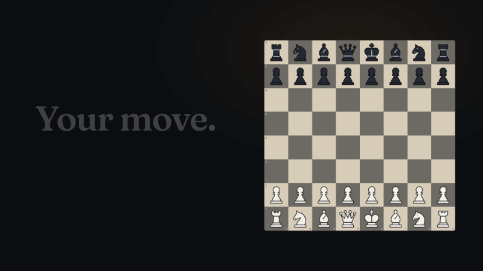
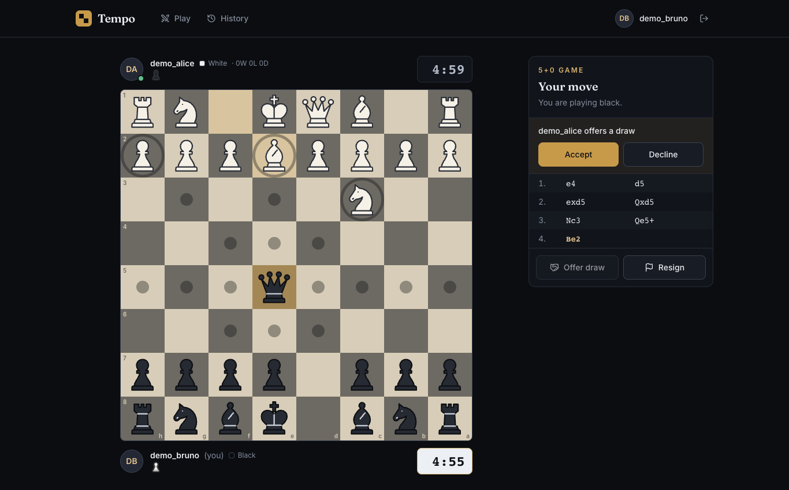
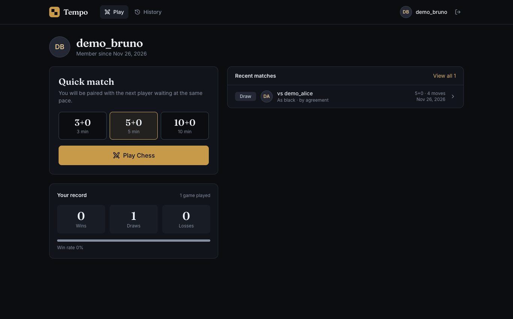
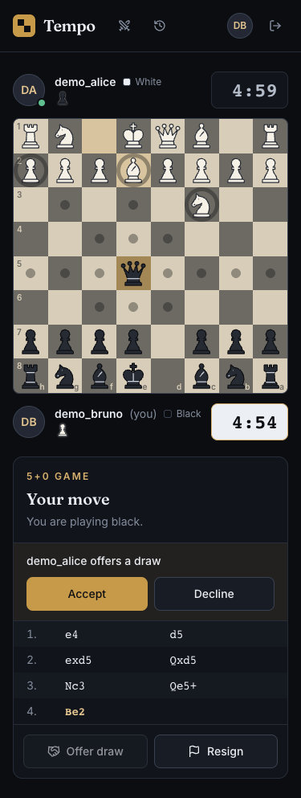
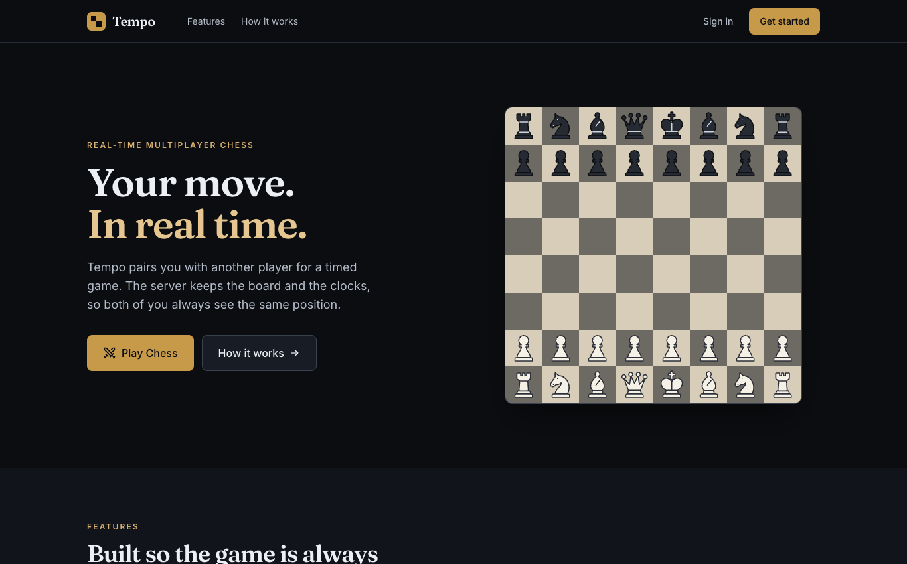
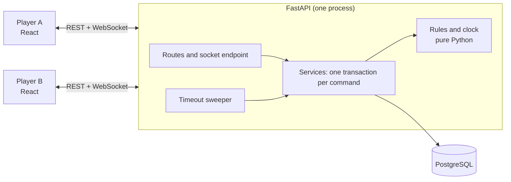

# Multiplayer Chess Platform

Full-stack real-time multiplayer chess platform built with FastAPI, React, TypeScript, WebSockets, and PostgreSQL.

[](https://github.com/Divine-K/multiplayer-chess-platform/actions/workflows/ci.yml)

Players create an account, are matched with another person, and play a timed game that both see live. The interface
is branded **Tempo**. The server is the only authority: the browser sends a move *request*, and the server checks who
sent it, whose turn it is, whether it is legal and whether time remains before anything changes.

[](docs/media/tempo.mp4)

<sub>A 20-second animated tour built from the app's own interface components. [Open the full video with sound.](docs/media/tempo.mp4)</sub>

## [Play it live](https://multiplayer-chess-2n5.pages.dev)

**https://multiplayer-chess-2n5.pages.dev** runs on free hosting, so after a quiet spell the first request can take
about a minute while the server wakes up. To play against yourself, use a normal window and a private window.



| Dashboard | Phone |
| --- | --- |
|  |  |

<details>
<summary>Landing page</summary>



</details>

## Features

- **Complete rules, enforced on the server:** castling, en passant, promotion, check, checkmate, stalemate,
  insufficient material, threefold repetition and the fifty-move rule.
- **Matchmaking** for 3, 5 and 10 minute games, safe when many players join at once.
- **Real-time play** over authenticated WebSockets, with reconnection after a refresh, dropped network or server
  restart.
- **Server-authoritative clocks** that keep running through disconnects and restarts, including timeout and
  timeout-versus-insufficient-material results.
- Resignation, draw offers, match history, and win/loss/draw records.
- **Board:** click or drag, full keyboard play, legal-move, last-move and check highlighting, promotion picker,
  captured pieces. Layouts for phone, tablet and desktop.
- **Security:** Argon2id password hashing, JWT auth, sign-in rate limiting, origin-checked and rate-limited sockets,
  and a Content-Security-Policy.

## Technology stack

| Layer | Technology |
| --- | --- |
| Frontend | React 19, TypeScript, Vite, Tailwind CSS v4, Framer Motion, Lucide, React Router |
| Backend | Python, FastAPI, Pydantic v2, WebSockets, python-chess |
| Database | PostgreSQL 16, SQLAlchemy 2.0, Alembic |
| Auth | JWT access tokens, Argon2id |
| Testing | Pytest, Vitest, React Testing Library, Playwright |
| Tooling | Docker Compose, GitHub Actions, Ruff, mypy (strict), oxlint |

## Architecture



**Life of a move:** the socket handler validates the message and already knows the user. The service locks the game
row, checks the seat, status, clock and turn, rebuilds the position from the stored moves, and validates the move
with python-chess. The move, clocks, any result and both players' statistics commit in one transaction. Only then are
both players sent the new state.

Decisions worth reading about in [docs/ARCHITECTURE.md](docs/ARCHITECTURE.md):

- A **row lock** protects the data; a per-game **async lock** keeps broadcast order equal to commit order.
- The clock never ticks in the database. It stores time remaining at the start of a turn, so it survives restarts.
- The browser has **no chess rules and makes no optimistic moves**, so its state cannot drift from the server's.
- A PostgreSQL **advisory lock** serialises pairing, and a partial unique index forbids two unfinished games per
  player.

## Run it with Docker

```bash
cp .env.example .env
```

Set `POSTGRES_PASSWORD` (letters and digits) and `JWT_SECRET_KEY` in `.env`, then:

```bash
docker compose up --build
```

Open `http://localhost:8080`. To play against yourself, use two separate sessions, for example a normal window and a
private window: tabs in the same window share one sign-in.

## Local development

Prerequisites: Python 3.12+ (developed on 3.14), Node.js 24, PostgreSQL 16.

### Database

```sql
CREATE ROLE chess WITH LOGIN PASSWORD 'choose-a-password';
CREATE DATABASE chess_dev  OWNER chess;
CREATE DATABASE chess_test OWNER chess;
```

### Backend

```bash
cd backend
python3 -m venv .venv
source .venv/bin/activate
pip install -r requirements-dev.txt
cp .env.example .env          # then edit DATABASE_URL and JWT_SECRET_KEY
alembic upgrade head          # create the schema
uvicorn app.main:app --reload # http://localhost:8000  (interactive API docs at /docs)
```

Generate a secret with `python -c "import secrets; print(secrets.token_urlsafe(48))"`.

### Frontend

```bash
cd frontend
npm install
cp .env.example .env.local    # optional; defaults to http://localhost:8000
npm run dev                   # http://localhost:5173
```

Open `http://localhost:5173`, not `127.0.0.1`: the allowed origin must match exactly.

## Environment variables

| Variable | Where | Description |
| --- | --- | --- |
| `DATABASE_URL` | backend | Required. `postgresql://…` URLs are accepted. |
| `JWT_SECRET_KEY` | backend | Required, 32+ characters. Production rejects the placeholders. |
| `ENVIRONMENT` | backend | `development` (default), `test` or `production`. |
| `ACCESS_TOKEN_EXPIRE_MINUTES` | backend | Default 60. |
| `CORS_ORIGINS` | backend | JSON list of exact browser origins. Default `["http://localhost:5173"]`. |
| `AUTH_RATE_LIMIT_PER_MINUTE` | backend | Sign-in and sign-up attempts per client. Default 20. |
| `CLIENT_IP_HEADER` | backend | Header in which the hosting edge supplies the visitor's address. Default none. |
| `TRUSTED_PROXY_HOPS` | backend | Otherwise, proxies in front of the API. Default 0. |
| `MATCHMAKING_STALE_SECONDS` | backend | Queue entry expiry without a status poll. Default 15. |
| `GAME_START_TIMEOUT_SECONDS` | backend | Abort a paired game that never starts. Default 60. |
| `WS_IDLE_TIMEOUT_SECONDS` | backend | Close silent sockets. Default 60. Other limits are in `app/core/config.py`. |
| `VITE_API_BASE_URL` | frontend | API origin, fixed at build time. Default `http://localhost:8000`. |

Real values live only in untracked `.env` files; the repository holds `.env.example` templates.

## API and WebSocket events

- [REST API](docs/API.md): registration and sign-in, profiles, matchmaking, games and history.
- [WebSocket protocol](docs/WEBSOCKET_PROTOCOL.md): `/ws/games/{id}`, authenticated by its first message.

| Client sends | Server sends |
| --- | --- |
| `auth`, `move`, `resign`, `offer_draw`, `accept_draw`, `decline_draw`, `sync`, `ping` | `connected`, `game_started`, `move_accepted`, `move_rejected`, `turn_changed`, `clock_updated`, `draw_offered`, `draw_declined`, `player_connected`, `player_disconnected`, `game_finished`, `state`, `pong`, `error` |

Database tables and constraints: [docs/DATABASE_SCHEMA.md](docs/DATABASE_SCHEMA.md).

## Testing

```bash
cd backend
pytest                 # unit and integration tests, real PostgreSQL
pytest tests_live      # full matches against a running API; about 10 minutes (real 3-minute clocks)
ruff check . && ruff format --check . && mypy app tests tests_live

cd ../frontend
npm test && npm run lint && npm run typecheck && npm run build
npm run test:e2e       # two-player browser tests; needs Chrome and a running stack
```

Both backend suites need a database whose name ends in `_test` (set in `backend/.env.test`) and **erase it**; they
refuse to run against any other name. Do not run the two at the same time, as they share it. For repeated browser
runs, raise `AUTH_RATE_LIMIT_PER_MINUTE`.

Coverage, results and what has *not* been tested: [docs/TESTING.md](docs/TESTING.md).

## Deployment

| Part | Host |
| --- | --- |
| Web app | Cloudflare Pages |
| API and WebSockets | Render ([health check](https://multiplayer-chess-api-2uro.onrender.com/health/ready)) |
| PostgreSQL | Neon |

Pushes to `main` redeploy: Render once the GitHub checks pass. Setup, free-plan limits and the verification checklist
are in [docs/DEPLOYMENT.md](docs/DEPLOYMENT.md).

## Repository layout

```
backend/    app/ (api, services, realtime, chess_core, models, schemas, core), migrations/,
            tests/ (unit and integration), tests_live/ (full matches against a running API)
frontend/   src/ (lib, components, features), e2e/ (browser tests)
docs/       architecture, API, protocol, schema, testing, deployment, development log
```

## Known limitations

- One API instance only: live connections are held in memory.
- Automated browser tests run in Google Chrome only. Firefox, Safari and physical touch devices have not been
  specifically tested.
- Finished games show the final position; you cannot step through earlier moves.
- No password reset, email verification or account deletion.
- The access token is stored in `localStorage` (see the trade-off in the architecture notes).
- No ratings, chat, spectators or time increments.

## Future improvements

- Redis or PostgreSQL `LISTEN/NOTIFY` pub/sub, to run several API instances.
- Elo or Glicko ratings and rating-aware matchmaking.
- Move-by-move replay and PGN export.
- Increment time controls (the clock already supports them) and rematches.
- Password reset by email, and refresh tokens.
- Route-level code splitting.

## License

[MIT](LICENSE) © 2026 Divine-K (Tempo)
