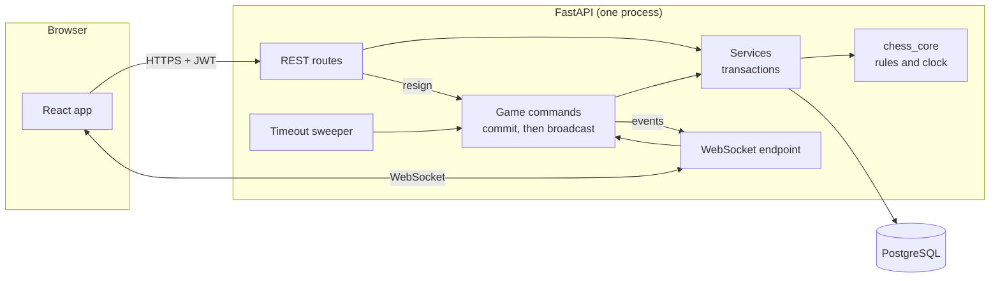

# Architecture

How the system fits together. See also the [database schema](DATABASE_SCHEMA.md), [REST API](API.md),
[WebSocket protocol](WEBSOCKET_PROTOCOL.md), [testing](TESTING.md) and [deployment](DEPLOYMENT.md).

## System overview



| Package | Contents |
| --- | --- |
| `api/` | thin HTTP layer: parse, call a service, map errors to status codes; rate limit and headers |
| `services/` | use cases and transactions: accounts, games, matchmaking, queries |
| `realtime/` | WebSocket endpoint, protocol, connection rooms, command layer, timeout sweeper |
| `chess_core/` | pure domain code: rules engine and clock (no database, no HTTP) |
| `models/`, `schemas/` | SQLAlchemy ORM and Pydantic types |
| `core/` | settings, password hashing, JWT, rate limiter |

### Authority principle

The server owns game state. Clients send intents ("move e2 to e4"); the server authenticates the user, checks
they belong to the game and it is their turn, validates the move with python-chess, persists it, and only then
broadcasts the result. The frontend never decides legality, time or results.

## Backend layering

| Layer | Responsibility | Must not |
| --- | --- | --- |
| `api/routes` | HTTP concerns, status codes | contain business rules or SQL |
| `services` | use cases, transactions, domain errors | know about HTTP |
| `models` | persistence mapping and constraints | contain workflow logic |
| `core/security.py` | pure password and JWT helpers | touch the database |

Services raise domain errors (`DuplicateAccountError`, `InvalidCredentialsError`); routes translate them into 409/401.

## Gameplay design

### Life of a move

1. The socket handler validates the message shape (Pydantic) and knows the user from the authenticated connection.
2. `GameCommands.move` takes the game's in-process lock, then runs the database work in a worker thread.
3. `game_service.submit_move` locks the game row (`SELECT … FOR UPDATE`), checks participation and status, checks
   the flag, checks the turn, rebuilds the position from the stored move list, and validates the move.
4. The move, new clock values, any result and both players' statistics are committed in **one transaction**.
5. The resulting snapshot is broadcast to both sockets while the in-process lock is still held, so events arrive in
   commit order.

Two locks, two jobs: the **row lock** protects data correctness (even against the REST API or the sweeper); the
**asyncio lock** keeps broadcast order matching commit order.

### Rules engine

python-chess provides move generation and rule detection; `chess_core/engine.py` is a small wrapper with typed errors.
The position is rebuilt by replaying all moves, because threefold repetition depends on history that a FEN does not
carry. The cost is linear in game length, which is negligible for chess.

Draw policy: threefold repetition and the fifty-move rule end the game automatically (no claim step). On flag fall,
the game is a draw if the opponent has insufficient material to mate (as judged by python-chess).

### Clocks

The clock never ticks. A game stores each side's remaining milliseconds plus `turn_started_at`; live values are
derived from the server's `now`. This is persistable (survives restarts), cannot be influenced by clients, and is
deterministic to test. A move that arrives after the flag has fallen is discarded, even if it would mate.
Network latency is charged to the player (no lag compensation).

A background sweeper flags expired games and aborts games that never started, using only database state. While any
game is unfinished it checks every 250 ms. With none, it stops querying (apart from a backstop every 15 minutes), so
a database that suspends when idle can do so. Matchmaking wakes it, and it always looks once at startup.

### Matchmaking

A FIFO queue table per time control. `join` and `cancel` take a transaction-scoped PostgreSQL advisory lock, so
pairing is serialised: simultaneous joiners cannot both miss each other or claim the same opponent. Backstops in the
schema: one queue entry per user (primary key), and one unfinished game per user (partial unique index on
`game_participants(user_id) WHERE is_active`). Colors are random. Clients poll for status, which doubles as a
heartbeat. A single global lock is deliberately simple; per-time-control locks are the next step if it ever contends.

## Authentication

- **Passwords:** Argon2id via `pwdlib`. Only the hash is stored.
- **Tokens:** HS256 JWTs with `sub`, `type`, `iat`, `exp`; all required on decode. The algorithm is pinned, so
  `alg: none` and wrong-secret tokens are rejected (covered by tests).
- **Login:** a dummy hash is verified when the email is unknown, and both failure modes return the identical
  401 body, so the endpoint does not reveal which emails are registered.
- **Protected routes:** `get_current_user` decodes the token and reloads the user, so deactivating an account
  invalidates its existing tokens immediately.
- **Frontend storage:** the token is kept in `localStorage`. Trade-off: any script running on the page could read it.
  Mitigations: a short token lifetime, no untrusted HTML rendering, and a Content-Security-Policy that allows scripts
  only from the app's own origin. An `HttpOnly` cookie would be stronger, but with the web app and API on different
  sites it would be a third-party cookie, which browsers increasingly block, and it would need CSRF protection.

## Security measures

| Risk | Measure |
| --- | --- |
| Password theft from the database | Argon2id hashes only |
| Password guessing and bulk sign-ups | per-client limit on sign-in and sign-up |
| Passwords leaking through errors | validation errors never repeat the input |
| Cheating | the server checks identity, seat, turn, legality and time; clients send only intents |
| Reading or joining others' games | seat checked on every REST call and socket |
| Cross-site WebSocket use | `Origin` allow-list, plus a token in the first message |
| Socket abuse | message size and rate limits, auth and idle timeouts, cap on sockets awaiting auth |
| Weak production settings | placeholder secrets and wildcard origins stop startup |
| Browser-side injection and framing | Content-Security-Policy and related headers |

## Performance notes

- Match history uses a fixed number of queries whatever the page size.
- Each move replays the game from its move list; the cost grows with game length and is small for chess.
- Blocking database work runs in worker threads, so it does not stall the event loop.
- The web app ships as one JavaScript bundle (about 154 kB gzipped).

## Database

Tables, constraints and indexes are described in [DATABASE_SCHEMA.md](DATABASE_SCHEMA.md).

## Frontend

```
src/lib/             API client and types, config, token storage, formatting, useAsync
src/components/      ui/ primitives (button, field, modal, toast, skeleton), layout/ shell and logo
src/features/
  auth/              session provider, route guards, sign-in and sign-up
  matchmaking/       search state and polling, shared by every signed-in page
  dashboard/         quick match, record, recent matches
  history/           paginated match history
  game/              board/ (rendering and input), session/ (socket, reducer, hook), game screen
  landing/           public page
src/test/            fake API, fake WebSocket and fixtures
e2e/                 Playwright tests against the real stack
```

All HTTP access goes through `lib/api/client.ts`, which centralises auth headers, error shape, network-failure
handling and the reaction to an expired token.

### Live game data flow

```
GameSocket  ->  sessionReducer  ->  GamePage / Board
(transport)     (latest snapshot)    (render, collect input)
     ^________________ move / resign / draw intents ___|
```

- **`GameSocket`** is plain TypeScript: first-message auth, heartbeat, dead-link detection, reconnection with
  backoff, and the close codes after which it must not retry.
- **`sessionReducer`** is a pure function. It replaces the whole game with each server snapshot and ignores any with
  an older `version`, so there is no client-side game state to drift.
- **No optimistic moves.** A sent move is marked as pending; pieces move only when the server answers. A lost
  connection clears the mark, and the snapshot received on reconnect says whether the move landed.
- **No chess rules.** `features/game/chess.ts` only reads piece placement from the FEN and filters the server's
  `legal_moves`.
- **Clocks** are animated locally from the time each snapshot arrived and re-based on every server message. They are
  never used to decide anything, and may lag the server by the network delay.

### Decisions

| Decision | Reason |
| --- | --- |
| Own board component and original SVG pieces, no board library | the server already supplies legal moves; this keeps input, accessibility and tests under our control |
| Matchmaking state above the routes | each status poll is the queue heartbeat, so changing page must not stop it |
| Context and a reducer, no state library | the shared state is small: session, search, and one game |
| Playwright with one browser context per player | separate storage, like two people on two machines |

## Known constraints

- Single API instance (connection rooms are in memory); see [WEBSOCKET_PROTOCOL.md](WEBSOCKET_PROTOCOL.md).
- A token is checked when a socket connects, not again during that socket's lifetime.
- Rate limiting covers sign-in and sign-up only. Its counts are in memory and reset on restart.
- Request body size is not limited by the app itself; a public deployment relies on the host's limits.
