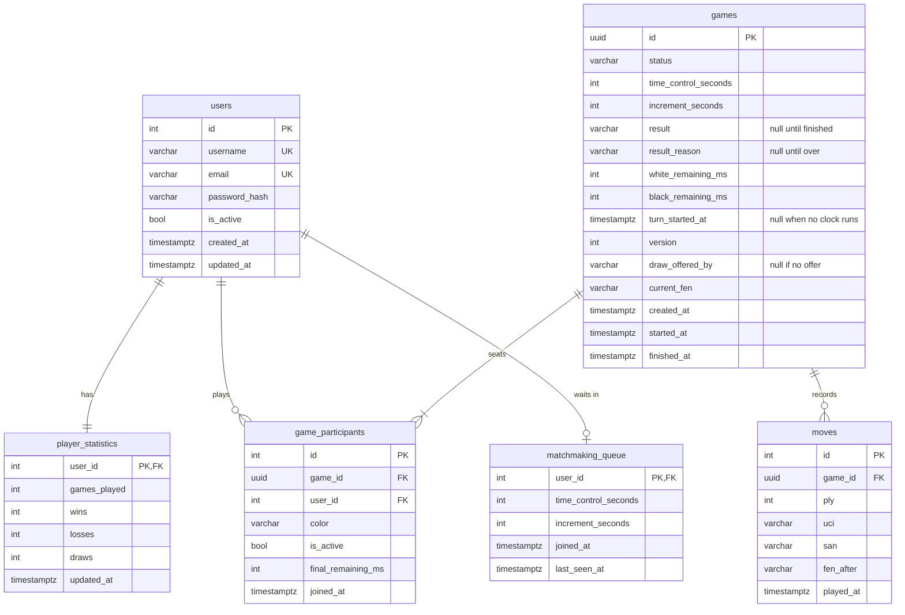

# Database schema

PostgreSQL 16, mapped with SQLAlchemy 2.0 and changed only through Alembic migrations
(`backend/migrations`). `tests/test_schema.py` fails if the models and migrations drift apart.



## Rules the database enforces

These hold even if application code has a bug or two requests race.

| Rule | How |
| --- | --- |
| Unique usernames and emails | unique constraints (emails are stored lower-cased by the application) |
| One player per colour, and a user at most once per game | unique `(game_id, color)` and `(game_id, user_id)` |
| A player is in at most one unfinished game | partial unique index on `game_participants(user_id) WHERE is_active` |
| One queue entry per user | `user_id` is the primary key of `matchmaking_queue` |
| No two moves with the same number | unique `(game_id, ply)`; `ply > 0` |
| `finished` games have a finish time, and only they do | check on `(status, finished_at)` |
| Clocks, time controls and counters are never negative | check constraints |
| `wins + losses + draws <= games_played` | check constraint |
| Only known statuses, results, reasons and colours | `VARCHAR` plus check constraints |
| Deleting a user or game removes its dependent rows | `ON DELETE CASCADE` foreign keys |

Deleting a user cascades to that user's seats but not to the `games` rows. The app never deletes accounts (it has
`is_active`); a manual clean-up should delete the games too.

## Indexes

| Index | Serves |
| --- | --- |
| `game_participants(user_id)` | a player's history |
| `game_participants(user_id) WHERE is_active` (unique) | finding the active game |
| `moves(game_id)` and unique `(game_id, ply)` | loading a game |
| `games(status)` | the timeout sweeper |
| `games(finished_at)` | history ordering |
| `matchmaking_queue(time_control_seconds, increment_seconds, joined_at)` | first-in, first-out pairing |

## Design notes

- **Clocks** store the time remaining as of `turn_started_at`; live values are computed from the server's time, so
  nothing is written while a clock runs.
- **Position:** the move list is the source of truth, because repetition detection needs history. `current_fen` and
  `moves.fen_after` are stored copies.
- **Statistics** are counters updated in the same transaction that finishes a game, using SQL-side increments.
- Enums are `VARCHAR` with checks rather than PostgreSQL enum types, which are awkward to change in migrations.
- Some check constraint names repeat their table prefix (for example `ck_games_ck_games_…`). It is cosmetic.

## Commands

```bash
alembic upgrade head                       # apply
alembic downgrade base                     # roll everything back
alembic revision --autogenerate -m "msg"   # new migration after changing models
alembic check                              # fails if models and migrations differ
```
